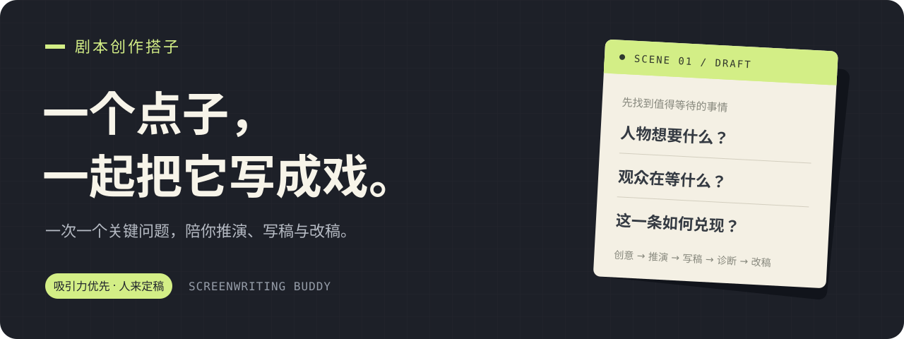

<div align="center">



# 剧本创作搭子

**你带来一个点子，我们一起把它写成观众愿意看下去的戏。**

面向抖音独立剧情短片与连续短剧的中文 Codex skill。

[](https://github.com/zac-wtf/screenwriting-buddy/releases/latest)
[](skills/screenwriting-buddy/SKILL.md)
[](#快速开始)

[快速开始](#快速开始) · [看看怎么合作](#看看怎么合作) · [使用示例](examples/README.md) · [提交反馈](https://github.com/zac-wtf/screenwriting-buddy/issues/new/choose)

</div>

## 它能帮你做什么

一个离奇设定、一段没写完的戏，或一句“我觉得不好看”，都可以成为起点。

搭子会和你一起找到值得等待的事情，把它写成场景与对白，再沿着观众接收信息的顺序检查：**为什么留下、正在等什么、得到什么、哪里可能失去兴趣。**

| 你现在的状态 | 可以一起完成 |
| --- | --- |
| 只有一个点子 | 找到核心事件、观看期待与结尾方向，开始写第一版 |
| 想做独立剧情短片 | 推演一次完整的事件，安排情绪与结尾兑现 |
| 想写连续短剧 | 推进当前这一集，再从结果中打开下一集的问题 |
| 有稿，但总觉得不对 | 定位影响观看的具体段落，提出有依据的改法 |
| 只想修一场戏或几句对白 | 调整行动、信息与人物关系，保留已经确定的方向 |

## 我们怎样合作

**一次一个关键问题。** 搭子给出建议和理由，你决定关键方向。核心事件、观看期待和结尾方向清楚后，就开始动笔。

**吸引力优先。** 先考虑观众为什么愿意看完当前这一条。允许夸张设定、强冲突和反转，人物动机与故事规则需要连贯；不把所有题材都写成同一种爽剧。

**会提出异议，也会给出改法。** “不好看”需要落到具体段落上。涉及核心人物、立意和结局的改变，由你决定；最终审核也由你负责。

> 点子 → 一个关键决策 → 第一版 → 沿观看过程诊断 → 针对性修改 → 人工审阅
>
> 这是合作路径，可以从任意阶段进入。

## 快速开始

### 1. 安装到 Codex

把下面这段话复制给支持技能安装的 Codex：

```text
请使用 skill-installer，从 GitHub 仓库 zac-wtf/screenwriting-buddy
的 skills/screenwriting-buddy 目录安装「剧本创作搭子」。
```

也可以下载 [最新技能包](https://github.com/zac-wtf/screenwriting-buddy/releases/latest) 手动安装，步骤见下方。

### 2. 带着一个点子开聊

```text
用 $screenwriting-buddy 和我一起发展这个抖音剧情创意：
一个能听见物品抱怨的维修工，接到了一件始终不肯说话的旧物。
先问一个影响故事方向的关键问题，并给出你的建议。
```

已经有方向时，可以补充时长、类型、必须保留的内容。也可以直接说“你定”或“先写一版”。

<details>
<summary><b>手动安装与更新</b></summary>

1. 在 [Releases](https://github.com/zac-wtf/screenwriting-buddy/releases) 下载 `screenwriting-buddy.skill`。
2. `.skill` 是 ZIP 格式的技能包。若解压工具不识别，先将扩展名改为 `.zip`，再解压。
3. 将得到的整个 `screenwriting-buddy` 文件夹放入 Codex 技能目录，默认是 `~/.codex/skills/`；设置了 `CODEX_HOME` 时，放入其 `skills/` 子目录。
4. 确认目录如下，在下一轮对话调用 `$screenwriting-buddy`；若界面尚未刷新，可新开一段对话。

```text
~/.codex/skills/
└── screenwriting-buddy/
    ├── SKILL.md
    ├── agents/openai.yaml
    └── references/
```

更新时先备份同名旧版本，再替换整个技能文件夹。不要额外嵌套两层 `screenwriting-buddy`。

安装前可以阅读 [技能入口](skills/screenwriting-buddy/SKILL.md)。它是一组 Markdown 创作指引；本仓库没有运行脚本，也不要求你配置独立的第三方 API Key。使用 Codex 本身的账号与服务要求仍由 Codex 决定。

</details>

## 看看怎么合作

以下是为说明合作方式编写的原创示例，不是实际使用记录或效果测试。

**你：**

> 一个能听见物品说话的维修工，接到一台始终不肯说话的旧录音机。我想做独立短片，结尾要有一点温暖。

**搭子：**

> 我建议先让观众好奇“它为什么不肯被修好”，再慢慢转向它舍不得失去的东西。
>
> 先定一个关键点：录音机不愿开口，是怕泄露秘密，还是怕最后一段录音再也播不出来？我推荐后者，更容易从悬念走向温暖。

**你：**

> 后者。先写开场。

**接下来，可以进入这样的戏：**

```text
1. 内景｜维修铺｜日

维修工拧下收音机的后盖。

收音机（只有维修工听见）：
上次那个零件装反了。我一到整点，就想吐天气预报。

门铃响。一位顾客把旧录音机放上柜台。

顾客：能让它再响一次吗？

维修工接上电源。磁带轮动了半圈，卡住。
他伸手去按播放键。

旧录音机（极轻，只有维修工听见）：
别按。我只剩这一次了。
```

开场先展示能力，再引出一个具体问题：录音机里的那一次声音，究竟是什么？后续需要兑现这个期待。

→ [查看改稿、模糊反馈和连续短剧示例](examples/README.md)

## 已有剧本，直接这样用

| 目标 | 可以复制的话 |
| --- | --- |
| 先审读 | 用 `$screenwriting-buddy` 审读这版剧本。优先检查观众为什么愿意看完，指出对应段落和原因，先不要重写全稿。 |
| 修一场戏 | 用 `$screenwriting-buddy` 修改这场戏。保留人物和结局，让冲突更多通过行动发生。 |
| 处理“不好看” | 用 `$screenwriting-buddy` 诊断这场戏哪里不好看。必要时只问我一个关键点，再给出局部修改。 |
| 写下一集 | 用 `$screenwriting-buddy` 推演下一集。沿用已定人物和规则，让上一集的结果引出新的处境。 |

在指令后附上稿件、前文或项目记录即可。

## 使用范围

- **适合：** 剧情点子、故事推演、大纲、独立短片、连续短剧、场景与对白、成稿诊断。
- **其他任务：** 普通文章、知识口播、纯广告文案、视频生成与剪辑，需要对应工具或技能。
- **人工负责：** 核心创意、关键取舍和最终审核。创作建议不等于真实观众反馈，也不承诺播放量、完播率或爆款结果。

本技能可独立使用。文中提到的 `screenwriting`、`human-writing`、`humanizer-zh` 等为可选方法入口，没有打包进本仓库，也不是安装依赖。

## 仓库导航

| 文件 | 内容 |
| --- | --- |
| [SKILL.md](skills/screenwriting-buddy/SKILL.md) | 技能入口、协作原则与任务路由 |
| [故事推演](skills/screenwriting-buddy/references/story-development.md) | 从点子进入故事，处理独立短片与连续短剧 |
| [场景与对白](skills/screenwriting-buddy/references/scene-dialogue.md) | 把设定、情绪和冲突写成可见可听的戏 |
| [观看过程与反馈诊断](skills/screenwriting-buddy/references/viewer-review.md) | 审读、不好看诊断与针对性修改 |
| [使用示例](examples/README.md) | 三种常见任务的输入与协作示范 |
| [反馈与贡献](CONTRIBUTING.md) | 怎样提供有用反馈、建议规则修改 |
| [更新记录](CHANGELOG.md) | 已发布版本与尚未发版的仓库更新 |

## 反馈与后续完善

使用时遇到了问题，欢迎 [提交反馈](https://github.com/zac-wtf/screenwriting-buddy/issues/new/choose)。一小段输入、期望行为和实际偏差，通常比“再聪明一点”更能帮助改进。请只分享你有权公开的材料。

接下来优先收集经过作者授权的真实改稿案例，对照修改前后与作者反馈；其他客户端的安装与表现，需要分别验证后再补充说明。

**许可状态：** 当前尚未指定开源许可证；具体授权范围由维护者决定。

## 致谢

仓库展示参考了 [video-shotcraft](https://github.com/Vincentwei1021/video-shotcraft) 的信息组织：用途说明、效果示例、安装入口与反馈路径。本仓库的封面和演示文字为本项目制作。
